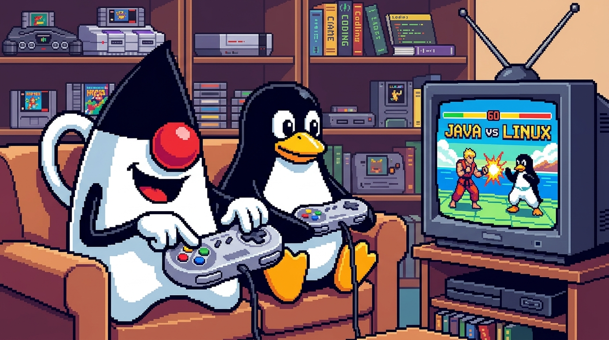

<p align="center">
  
</p>

# SuperJavendo

A **Super Nintendo (SNES)** emulator written in **Java**, with no external libraries: just the JDK, Swing and `javax.sound`.

## Why

This project exists to **re-study the architectures of the console hardware that made history** and to
reimplement them from scratch. Choosing Java for this kind of work would once have been a poor idea: the virtual
machine, the garbage collector and the performance left no headroom for emulating, in real time, hardware with
several processors, two video chips and a dedicated sound subsystem. Today, with modern JIT compilers, fast
hardware and good development tools, it is not only possible but pleasant: the code stays readable, portable and testable.

The SNES is the first target. The goal is to grow, one architecture at a time, into a small "museum" of consoles
rebuilt with the same philosophy: understand how the hardware worked, write the simplest model that reproduces it
faithfully, and validate it with automated tests and test ROMs.

## Current status

Runs **Street Fighter II (USA)** with graphics, parallax scrolling and audio.

| Component | Status |
|---|---|
| 65816 CPU | complete, validated against the *SingleStepTests* per-instruction suite |
| Timing | scanline scheduler (262 lines × 1364 master clocks), VBlank, H/V NMI and IRQ, joypad auto-read |
| DMA / HDMA | direct and indirect; HDMA including the quirks real games rely on |
| PPU | modes 0–4 and 7, sprites, windows, mosaic, colour math (main and sub screen) |
| Audio | SPC700 with the real IPL ROM, DSP (BRR, ADSR/GAIN, noise, echo, interpolation), 48 kHz output |
| Cartridges | LoROM and HiROM, battery SRAM saved to a `.srm` file |
| Input | keyboard and Linux gamepads (`/dev/input/js*`), configurable profiles, players on ports 1 and 2 |
| Save states | 4 slots from the keyboard + a quick slot from the gamepad, with an embedded screenshot |
| Frontend | game list with folder scanning, preview, reset, graphical controller configurator |

### Missing

- **Special chips** (SuperFX, SA-1, DSP-n, Cx4, S-DD1, …): list and suggested order in [`docs/special-chip-games.md`](docs/special-chip-games.md).
- High-resolution video modes (5/6) and interlacing.
- Multitap (more than 2 players) and special peripherals (mouse, Super Scope).
- Accuracy is scanline-level (snes9x style), not cycle-level (bsnes style): games that are very sensitive to timing may diverge.

## Requirements

- JDK 21 or newer (developed with JDK 27)
- Maven 3.9+
- Linux (gamepad support uses the kernel joystick API; everything else is plain Java)

You need a **ROM you own**: no commercial ROMs are included, and none ever will be.

## Build and run

```sh
mvn package                 # builds and runs the tests → target/superjavendo.jar

java -jar target/superjavendo.jar                       # opens the game list
java -jar target/superjavendo.jar game.sfc              # starts a ROM directly
java -jar target/superjavendo.jar game.sfc -p1 easysmx -p2 keyboard2   # controller profile per player
java -jar target/superjavendo.jar --controllers         # controller configurator only
```

### In-game controls

| Key | Action |
|---|---|
| arrows, Z, X, A, S, Q, W, Enter, Shift | D-pad, B, A, Y, X, L, R, Start, Select (`keyboard` profile, editable) |
| `1`…`4` / Shift+`1`…`4` | save / load slot 1…4 |
| F5 / F9, or the pad's `save_state`/`load_state` buttons | save / load the quick slot (0) |
| `P` | pause |
| `Esc` | quit |

## Frontend

- **Game list**: "Scansiona cartella…" (scan folder) searches recursively for ROMs and records them in `~/.config/superjavendo/game.list`.
  Selecting a game shows the screenshot of its last save, or its cover art
  (`~/.config/superjavendo/game-covers/<rom name>.png`; covers are copyrighted and are not in the repository).
- **START / RESET** launch and reset the game, which runs in a separate window.
- **Controller configurator**: an image of an SNES pad; click a button to see its bound inputs and add or
  remove a binding by pressing the key (or the joystick button).

The frontend UI is currently in Italian.

## Configuration

Everything lives in `~/.config/superjavendo/` (or `$XDG_CONFIG_HOME/superjavendo/`):

```
controllers.cfg          # which profiles each player uses: player1=keyboard,easysmx@0
joystick/<name>.cfg      # one profile per device (created on first run: keyboard, keyboard2, easysmx, xbox)
states/<rom>.state       # slot 0;  <rom>.N.state for slots 1…4
game.list                # games found by the scan
game-covers/             # optional cover art
```

A profile is a plain text file, one button per line:

```
type=gamepad
name=EasySMX
up=AXIS_7-,AXIS_1-       # several inputs on the same button, comma separated
b=BUTTON_0
l=BUTTON_6,BUTTON_8      # L1 and L2 together
save_state=BUTTON_13
```

Keyboard: Linux key names (`KEY_UP`, `KEY_Z`, …). Joystick: `BUTTON_n`, `AXIS_n+`, `AXIS_n-` (numbers from `jstest /dev/input/js0`).

## Architecture

The code lives in `src/main/java/dev/superjavendo/`, one package per hardware component:

```
cpu/        65816 CPU
bus/        address bus, memory map, I/O registers
cart/       header, LoROM/HiROM, SRAM
timing/     timing constants
dma/        DMA and HDMA
ppu/        PPU: scanline renderer
apu/        SPC700, DSP and communication ports
input/      joypad, controller strategies (keyboard, gamepad), profiles
state/      save-state serialisation
config/     application paths
ui/         emulation window and audio output
frontend/   game list and controller configurator
Snes.java   wires the components together and runs the scheduler
```

Design choices: controllers are interchangeable *strategies* (`ControllerInput`), profiles are plain data, and
component state is serialisable (`Stateful`) so save states are deterministic.

## Testing and comparison with other emulators

- `mvn test`: unit tests for CPU, PPU, APU, scheduler, save states, input and frontend.
- [`test_roms/`](test_roms/README.md): third-party homebrew test ROMs (PeterLemon/SNES) for deterministic checks, local use only (not tracked in git).
- [`diff.md`](docs/diff.md): procedure to compare SuperJavendo frame by frame with snes9x (libretro core)
  using identical inputs; tools are in `tools/diff/`.

## Legal

SuperJavendo is an educational project. It does not contain or distribute ROMs, BIOS images or copyrighted cover art.
*Super Nintendo* and *SNES* are trademarks of Nintendo; this project is not affiliated with or endorsed by Nintendo.
